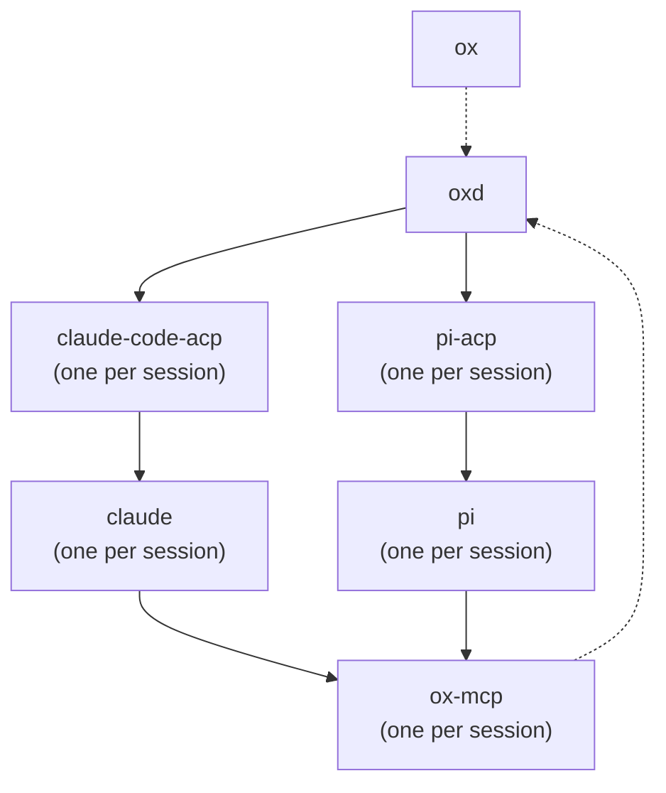

# Architecture

Ox separates the desktop interface from session execution. The desktop app,
Ox's only user interface, is a client of `oxd`, a per-user daemon that owns
session state and agent processes. Closing a client leaves its sessions running. Saved
sessions and conversations also survive a daemon restart.

## Processes and communication

Solid arrows show process ownership. Dotted arrows show connections to the
daemon over a Unix socket. Clients start the `oxd` beside their own executable,
detached, when no daemon answers; startup and instance locks keep one daemon
per socket. The daemon accepts connections only from its own user.

The socket is `$OX_SOCKET` when set. Otherwise it is `oxd.sock` in
`$XDG_DATA_HOME/ox` when `XDG_DATA_HOME` is an absolute path, or in
`~/.local/share/ox`. The database is `<socket>.db`, and the daemon appends its
stderr to `oxd.log` beside the socket.

A connection opens with `hello`, which carries the protocol version: a hash of
the `ox-protocol` crate's source, computed when it builds. The daemon refuses
a client whose version differs from its own, and the app then says that `oxd`
is running a different build of Ox. `daemon.stop` is the one method accepted
before `hello`, and its wire form stays the same in every build, so any
build's `oxd --stop` stops any later build's daemon. The daemon stops only
when every session is `idle` or `exited`; otherwise it refuses, naming the
busy sessions.

### Desktop client

The desktop app uses Tauri 2. Its React webview calls the Rust core through
Tauri commands; the core uses `ox_protocol::Client` to talk to `oxd` and
streams updates back over Tauri channels.

The app offers an agent for each [harness](glossary.md) that Ox's config
lists and that is on the `PATH` it passes to sessions, and reads both again
each time its window gains focus.

### Ox's config

`config.json` in Ox's config directory, `$XDG_CONFIG_HOME/ox` when
`XDG_CONFIG_HOME` is absolute and `~/.config/ox` otherwise, holds Ox's
settings. Its `harnesses` object lists, for each harness by executable name,
the models Ox offers, each with its effort levels and an optional provider
name, and the harness's modes, in the order pickers offer them. The desktop
core reads it for the `agents` command, the daemon for each
`session.request`, and `ox-mcp` for each `list_harnesses` call, so an edit
applies at the next window focus, request, or listing. `config/config.json`
is the example `make install` copies into place when no config exists.

### Daemon and agents

`oxd` runs each session's agent in a separate process group and speaks ACP
over its standard input and output. Stopping the agent terminates that
process group, including its children.

The bundled agents bridge draft ACP v2 to the Claude Code and Pi CLIs. Each
bridge process serves one session, whose ID is the harness's own session ID.
The harness keeps the conversation and `oxd` keeps everything else, so the
bridges store nothing.

`claude-code-acp` keeps one Claude process running between prompts, exchanging
stream-json messages and control requests with it.
Claude authenticates with the user's subscription. The bridge can restart
an exited Claude process on the same session.

Each bridge reports its `model`, `effort`, and `mode` options with their
current values and passes any value it is set to through to its harness.
What a session can choose from comes from Ox's config.

`pi-acp` runs one `pi --mode rpc --approve` process per session, loading the
project's settings, skills, and extensions, and an extension of its own that
registers the client's MCP servers with Pi. The bridge exchanges JSONL commands
and events with Pi, using the providers and credentials configured in Pi. It
can restart an exited Pi on the same session.

[ACP v2 support](acp-v2.md) owns protocol details and integration caveats.

### ox-mcp

`oxd` supplies each compatible agent with a session-scoped `ox-mcp` stdio
server. The agent launches it. Its tools call back into the daemon for that
session:

| Tool | Daemon method | Does |
| --- | --- | --- |
| `set_title` | `session.set_title` | Sets the session title |
| `read_transcript` | `session.transcript` | Reads a page of any session's compact transcript |
| `list_sessions` | `watch` | Lists the workspaces and the sessions the agent can message |
| `send_message` | `session.send_message` | Sends a [peer message](glossary.md) to another session |
| `start_session` | `session.request` | Asks the user to start a new session |
| `list_harnesses` | none; reads Ox's config | Lists the harnesses, models, effort levels, and modes a session can start with |

Each tool call opens and closes its own daemon connection, so the MCP server
does not keep the daemon alive between calls.

### Instructions

`oxd` gives each agent with the `ox` tools instructions about Ox: to title
its session with `set_title`. An agent that advertises
`session.systemPrompt` gets the instructions in its system prompt when its
session is opened or resumed. Another gets them as a text block before a new
session's first prompt.

## Ownership boundaries

`oxd` owns:

- Shared persistent state: workspaces, sessions, and conversation history.
- Agent processes and work that must continue when a client disconnects,
  including each session's [queue](glossary.md) of prompts.
- State updates and pending requests that every connected client must see.
- Each connection's [focus](glossary.md) and the unseen outcome of each
  session, which a focus clears and a turn ending out of focus sets.
- Repository writes and the coordination needed to complete or undo them.

Clients own presentation and workflow choices: which branch to use, which
comparison ref to select, and which daemon operations to request in what
order. The daemon exposes repository operations without choosing the user's
workflow. Local presentation state stays in the webview's storage: file-tree
expansion and scroll position, drafts, unsent messages, and the option values
last used with each agent in each workspace.

Clients pass their environment when starting an agent and requesting Git
operations. The daemon does not persist that environment. For Git operations
that take a client's environment, it overlays the daemon's environment,
removing Git variables that would redirect an operation to another repository.

Directory watches also belong to the daemon. Clients request the directories
they need; the daemon shares one non-recursive watch per directory across
consumers and releases it when the last consumer stops watching. The file tree
subscribes only for open folders. File content subscriptions share these watches
on the file’s parent directory and send changed text or read errors. The viewer
keeps each session’s open file, split ratio, scroll position, current content,
and whether Markdown shows as source or preview in browser memory. Open viewers stay subscribed while their session is inactive,
so switching sessions can restore the viewer before paint. Closing a viewer or
deleting its session releases its subscription.

[Performance](performance.md) describes how changes flow through the
daemon, desktop core, and UI without reprocessing unrelated state.

## Persistence and recovery

`oxd` is the only writer of the SQLite database beside its socket. The
database holds workspace and session metadata, worktrees with their
comparison refs, archive state, each session's queue and config,
conversation events, and the agent session IDs of deleted sessions, which keep
an import from bringing them back. Each conversation event is saved with the time `oxd`
recorded it; an imported event, with the time its transcript gives.

The database's `PRAGMA user_version` is its schema version. `oxd` brings an
older database to the version it writes by applying the migration steps in
`crates/oxd/src/store.rs` it has not had, all in one transaction, and refuses
to open a database of a newer version. Stored JSON is part of the schema: a
change to how `EventKind` (including the ACP updates it holds),
`QueuedPrompt`, `ConfigSetting`, or a session's command serializes either
still reads every older shape or comes with a migration step that rewrites
the rows. Each schema version has a SQL fixture in
`crates/oxd/tests/fixtures`, and a test opens every fixture with the current
code. Values the UI keeps in local storage follow the same rule: a new shape
still reads what the previous build wrote.

Session metadata is saved as sessions are created, and each change to it is
saved in the step that makes the change, before clients are told. Conversation
events are queued and committed in batches, ordered by session and sequence
number. Graceful shutdown drains the queue. A forced stop can lose queued
events; a failed batch is logged and dropped, leaving gaps in saved history.

Saved history includes tool output and images and can be read without
starting an agent. It is loaded on demand after a daemon restart, with
interrupted turns ended as errors, unresolved requests cancelled, and steered
prompts the agent had not taken in dropped.

Ox's saved conversation and the agent's resumable conversation are separate.
Continuing a Claude session requires its native transcript even when Ox still
has the displayed history. Claude's transcript retention is controlled by
its [`cleanupPeriodDays` setting](https://code.claude.com/docs/en/data-usage#data-retention).
Continuing a Pi session requires its Pi session file. Each bridge keeps its
session records separately from the daemon's database.

## Session lifecycle

A saved session belongs to a workspace and records its agent command,
working directory, agent session ID, and config. Its lifetime is independent
of any client connection and of the agent process currently serving it. A workspace
cannot be removed while sessions still belong to it.

The daemon owns turn state, including turns the agent starts without a
client prompt. A session's requests reach its agent in the order a
connection sends them, so a prompt sent after a config change runs with the
new value. Agent state updates drive the turn lifecycle; the prompt
response acknowledges insertion rather than turn completion. Permission
requests and form elicitations are recorded with the session and can be
answered by clients.

A new session can carry its first prompt and its config. The daemon records
both, and titles the session from the prompt's text, when it creates the
session, before the agent or worktree exists. Once the agent starts, the
daemon sends it every setting of the config and then the prompt. A session
whose agent or worktree fails to start ends the prompt's turn with the error.

A session's config is the model, effort, and mode Ox set its agent to, and
the composer shows it. `session.set_config` replaces it whole: the daemon
sends the agent each setting, and records the new config once the agent has
accepted every setting, or only the settings it accepted. What the agent
reports about its options is recorded as events and changes neither the
config nor the composer. A session created without a config, such as an
imported one, takes the model, effort, and mode its agent reports when it
starts.

A prompt sent during a turn steers it: the daemon sends it to the agent at
once, records it as steered, and records it as taken when the agent answers
it, or dropped when the agent refuses it, drops it on cancellation, or exits
first. A steered prompt still pending when the turn ends starts a turn of the
agent's own.

A peer message starts a turn or steers the running one as a prompt does,
recorded with its sender's ID and title. The agent gets its text after a
header that names the sender. A peer message leaves a held queue held. A
recipient whose agent is not running, parked or restored after a daemon
restart, is loaded first with the sender's environment, and the message is
sent once its agent has started.

An agent asks to start a session through a permission request the daemon
records on the agent's own session, titled with the workspace and carrying the
requested session for the request panel: the harness, the names of its model,
effort, and mode, the checkout, and the prompt. The daemon checks the request
before asking: the workspace, the checkout and branch, the harness's bridge,
and the harness, model, effort, and mode against Ox's config. Starting it
creates the session as a client's `session.new` would, with the requester's
environment; declining it, or stopping the requester's turn, creates nothing.

A new session's first prompt waits for the agent's answers to the session's
config. When the agent refuses a setting, the prompt is not sent and its turn
ends with an error naming each refused setting.

`workspace.import_claude_sessions` imports the Claude sessions started in a
workspace's directory. The daemon runs the Claude bridge beside its executable
with the client's environment: `--sessions` lists the sessions, and
`--transcript` reads each one Ox has not had, newest first. The daemon turns
each transcript's updates into turns, one for each user message, and saves the
session archived and exited with that history, as a session restored after a
restart is. A session whose history holds a prompt keeps it when it loads, so
an imported session resumes without replay.

Each session keeps a queue of prompts. Whenever the session's agent is idle,
with no pending request, no steered prompt pending, and no branch move under
way in its checkout, the daemon starts the queue's first prompt as a turn, whether or not a client is connected. A
cancelled turn, or one that ends other than with `end_turn`, holds the queue
until a client sends a prompt or sends a queued one now.

### Loading and stopping agents

After a daemon restart, every saved session returns `exited`, without a
running agent. A session whose agent never started keeps its history,
including its first prompt and the error that ended it, and cannot load. Loading
a session starts its stored command in its stored directory, resumes the
agent's conversation, and sends it the session's config again, retaining
the Ox session ID and subscriptions. Missing history can be recovered through
the agent's replay support.

An idle session with no subscribers, pending requests, or reported background
work can have its agent parked after an idle delay, 15 minutes unless
`oxd --park-after-ms` sets it. Parking preserves the session's conversation
and checkout; loading the session starts its agent again. Agents that do not
report background-work state are never parked.

Archiving and deleting stop the agent. An archived session loads once it is
unarchived; deleting a session removes its saved history.
[Where sessions run](../worktrees.md#deleting-and-archiving) owns what each
does to the worktree and branch.

Worktree startup, load, parking, archiving, unarchiving, deletion, and
workspace removal coordinate through a per-session lifecycle lock. Shutdown stops agents but preserves saved sessions. Each
connected client then receives the rest of every session it follows, up to
the session's close, before the daemon exits; a client that has not read
it within five seconds is disconnected. The daemon can exit when it has no
clients or running agents; exited sessions do not keep it alive.

## Repository ownership

A session runs in the workspace's existing checkout or in an additional Git
worktree owned by Ox. Each worktree belongs to a session. The daemon uses
the Git CLI for repository operations.
[Where sessions run](../worktrees.md) owns checkout choices, branch
comparisons, merge behavior, and cleanup rules.

The daemon saves each worktree as its own record and lists it to clients as
its own entry, which a session refers to by ID. A worktree computes one
branch comparison and publishes it with its entry.

Worktree creation separates reserving and saving the worktree and its
session from adding the worktree. The daemon records the worktree and branch
ownership before returning a starting session, and launches the session's
agent once the worktree is added. Failure to add the worktree triggers
cleanup of the partial worktree and of a newly created branch still at its
starting commit, and the worktree's record is removed. A session whose agent
never started keeps its worktree and stays `exited` with its error, across
daemon restarts, until it is deleted.

Each worktree records the repository's common Git directory, so cleanup and
branch operations do not depend on the workspace directory still existing.
Deletion waits for startup, checks for unsaved work before removing the
checkout, and applies the branch cleanup rule separately.

Branch moves use Git ref transactions to check the commits the client
expected, including a source branch when supplied. If updating a checked-out
branch's files fails, the daemon attempts to restore its previous tip and
reports the failure. While a branch moves, the sessions in its checkout refuse
prompts and loads, and their queues wait.
[Where sessions run](../worktrees.md#moving-a-branch) owns the checks and
limitations.
