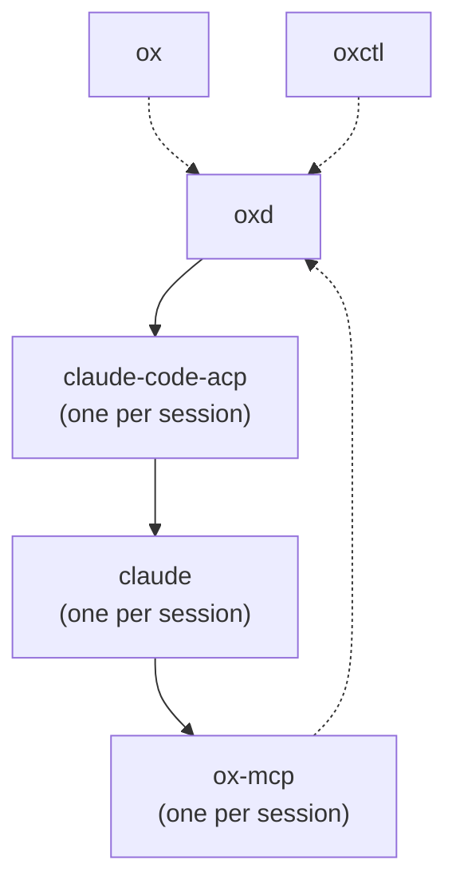

# Architecture

Ox separates the desktop interface from session execution. The desktop app
and `oxctl` are clients of `oxd`, a per-user daemon that owns session state
and agent processes. Closing a client leaves its sessions running. Saved
sessions and conversations also survive a daemon restart.

## Processes and communication

Solid arrows show process ownership. Dotted arrows show connections to the
daemon over a Unix socket. Clients start the daemon detached when needed;
startup and instance locks keep one daemon per socket. The daemon accepts
connections only from its own user.

### Desktop and command-line clients

The desktop app uses Tauri 2. Its React webview calls the Rust core through
Tauri commands; the core uses `ox_protocol::Client` to talk to `oxd` and
streams updates back over Tauri channels. `oxctl` uses the same daemon client
and gives the integration tests access to the same operations.

### Daemon and agents

`oxd` runs each session's agent in a separate process group and speaks ACP
over its standard input and output. Stopping the agent terminates that
process group, including its children.

The bundled agent is `claude-code-acp`, a bridge between draft ACP v2 and the
Claude Code CLI. Each bridge keeps one Claude process running between
prompts, exchanging stream-json messages and control requests with it.
Claude authenticates with the user's subscription. The bridge can restart
an exited Claude process using its native session ID.

[ACP v2 support](acp-v2.md) owns protocol details and integration caveats.

### ox-mcp

`oxd` supplies each compatible agent with a session-scoped `ox-mcp` stdio
server. The agent launches it. Its tools call back into the daemon for that
session; the current tool lets the agent set the session title.

Each tool call opens and closes its own daemon connection, so the MCP server
does not keep the daemon alive between calls.

## Ownership boundaries

`oxd` owns:

- Shared persistent state: workspaces, sessions, and conversation history.
- Agent processes and work that must continue when a client disconnects.
- State updates and pending requests that every connected client must see.
- Repository writes and the coordination needed to complete or undo them.

Clients own presentation and workflow choices: which branch to use, which
comparison ref to select, and which daemon operations to request in what
order. The daemon exposes repository operations without choosing the user's
workflow. Local presentation state, such as file-tree expansion and scroll
position, stays in the webview's storage.

Clients pass their environment when starting an agent and requesting Git
operations. The daemon does not persist that environment. For Git operations
that take a client's environment, it overlays the daemon's environment,
removing Git variables that would redirect an operation to another repository.

Directory watches also belong to the daemon. Clients request the directories
they need; the daemon shares one non-recursive watch per directory across
consumers and releases it when the last consumer stops watching. The file tree
subscribes only for open folders.

[Performance](performance.md) describes how changes flow through the
daemon, desktop core, and UI without reprocessing unrelated state.

## Persistence and recovery

`oxd` is the only writer of the SQLite database beside its socket. The
database holds workspace and session metadata, worktree ownership,
comparison refs, archive state, and conversation events.
The database schema has no migrations.

Session metadata is saved as sessions are created or changed. Conversation
events are queued and committed in batches, ordered by session and sequence
number. Graceful shutdown drains the queue. A forced stop can lose queued
events; a failed batch is logged and dropped, leaving gaps in saved history.

Saved history includes tool output and images and can be read without
starting an agent. It is loaded on demand after a daemon restart, with
interrupted turns ended as errors and unresolved requests cancelled.

Ox's saved conversation and the agent's resumable conversation are separate.
Continuing a Claude session requires its native transcript even when Ox still
has the displayed history. Claude's transcript retention is controlled by
its [`cleanupPeriodDays` setting](https://code.claude.com/docs/en/data-usage#data-retention).
The bridge keeps its session records separately from the daemon's database.

## Session lifecycle

A saved session belongs to a workspace and records its agent command,
working directory, and agent session ID. Its lifetime is independent of any
client connection and of the agent process currently serving it. A workspace
cannot be removed while sessions still belong to it.

The daemon owns turn state, including turns the agent starts without a
client prompt. Agent state updates drive the turn lifecycle; the prompt
response acknowledges insertion rather than turn completion. Permission
requests and form elicitations are recorded with the session and can be
answered by clients.

### Loading and stopping agents

After a daemon restart, saved sessions begin without running agents. Loading
a session starts its stored command in its stored directory and resumes the
agent's conversation, retaining the Ox session ID and subscriptions. Missing
history can be recovered through the agent's replay support.

An idle session with no subscribers, pending requests, or reported background
work can have its agent parked. Parking preserves the session's conversation
and checkout; loading the session starts its agent again. Agents that do not
report background-work state are never parked.

Archiving stops the agent and removes its worktree while retaining the
conversation and branch. An archived session cannot load until unarchived.
Deleting a session stops the agent and removes its saved history, with
repository cleanup governed by the
[worktree deletion and archiving rules](../worktrees.md#deleting-and-archiving).

Startup, load, parking, and deletion coordinate through a per-session
lifecycle lock. Shutdown stops agents but preserves saved sessions. The
daemon can exit when it has no clients or running agents; exited sessions
do not keep it alive.

## Repository ownership

A session runs in the workspace's existing checkout or in an additional Git
worktree owned by Ox. The daemon uses the Git CLI for repository operations.
[Where sessions run](../worktrees.md) owns checkout choices, branch
comparisons, merge behavior, and cleanup rules.

Worktree creation separates reserving and saving the session from adding
the worktree and launching the agent. The daemon records the worktree and
branch ownership before returning a starting session. Failure to add the
worktree triggers cleanup of the partial worktree and of a newly created
branch still at its starting commit. Restart cleanup revisits sessions that
never started, preserving worktrees whose removal would lose work.

Each worktree records the repository's common Git directory, so cleanup and
branch operations do not depend on the workspace directory still existing.
Deletion waits for startup, checks for unsaved work before removing the
checkout, and applies the branch cleanup rule separately.

Branch moves use Git ref transactions to check the commits the client
expected, including a source branch when supplied. If updating a checked-out
branch's files fails, the daemon attempts to restore its previous tip and
reports the failure. The user guide documents the
[checks and limitations](../worktrees.md#moving-a-branch).
