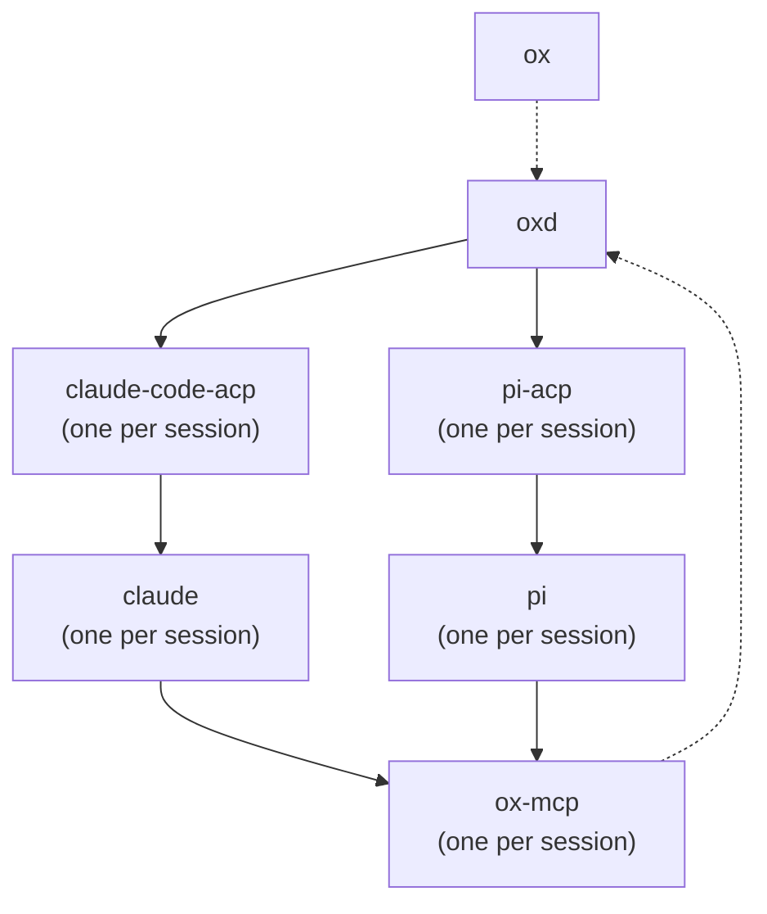

# Architecture

Ox separates the desktop interface from session execution. The desktop app,
Ox's only user interface, is a client of `oxd`, a per-user daemon that owns
session state and agent processes. Closing a client leaves its sessions running. Saved
sessions and conversations also survive a daemon restart.

## Processes and communication

Solid arrows show process ownership. Dotted arrows show connections to the
daemon over a Unix socket. Clients start the `oxd` beside their own executable,
detached, when no daemon answers; startup and instance locks keep one daemon
per socket. The daemon accepts connections only from its own user.

The socket is `$OX_SOCKET` when set. Otherwise it is `oxd.sock` in
`$XDG_DATA_HOME/ox` when `XDG_DATA_HOME` is an absolute path, or in
`~/.local/share/ox`. The database is `<socket>.db`, and the daemon appends its
stderr to `oxd.log` beside the socket.

### Desktop client

The desktop app uses Tauri 2. Its React webview calls the Rust core through
Tauri commands; the core uses `ox_protocol::Client` to talk to `oxd` and
streams updates back over Tauri channels. The core keeps one conversation
view per channel, so the run view follows every child session of a run at
once.

The app offers an agent for each [harness](glossary.md) on the `PATH` it
passes to sessions, and checks again each time its window gains focus.

### Daemon and agents

`oxd` runs each session's agent in a separate process group and speaks ACP
over its standard input and output. Stopping the agent terminates that
process group, including its children.

The bundled agents bridge draft ACP v2 to the Claude Code and Pi CLIs. Each
bridge process serves one session, whose ID is the harness's own session ID.
The harness keeps the conversation and `oxd` keeps everything else, so the
bridges store nothing.

`claude-code-acp` keeps one Claude process running between prompts, exchanging
stream-json messages and control requests with it.
Claude authenticates with the user's subscription. The bridge can restart
an exited Claude process on the same session.

Each bridge's `--describe <dir>` mode prints the config options and slash
commands its harness offers a new session in `<dir>`, starting the harness
briefly with no prompt and no saved session. The desktop core runs it to show
a draft's controls.

`pi-acp` runs one `pi --mode rpc --approve` process per session, loading the
project's settings, skills, and extensions, and an extension of its own that
registers the client's MCP servers with Pi. The bridge exchanges JSONL commands
and events with Pi, using the providers and credentials configured in Pi. It
can restart an exited Pi on the same session.

[ACP v2 support](acp-v2.md) owns protocol details and integration caveats.

### ox-mcp

`oxd` supplies each compatible agent with a session-scoped `ox-mcp` stdio
server. The agent launches it. Its tools call back into the daemon for that
session: `set_title` sets the session title.

Each tool call opens and closes its own daemon connection, so the MCP server
does not keep the daemon alive between calls.

### Instructions

`oxd` gives each agent instructions about Ox when any apply. An agent with
the `ox` tools is told to title its session with `set_title`. A run's child
session is told which step of which workflow it runs and that its final
reply is the next step's input. An agent that advertises
`session.systemPrompt` gets the instructions in its system prompt when its
session is opened or resumed. Another gets them as a text block before a new
session's first prompt.

## Ownership boundaries

`oxd` owns:

- Shared persistent state: workspaces, sessions, workflow runs, and
  conversation history.
- Agent processes and work that must continue when a client disconnects,
  including each session's [queue](glossary.md) of prompts.
- State updates and pending requests that every connected client must see.
- Each connection's [focus](glossary.md) and the unseen outcome of each
  session and run, which a focus clears and a turn or run ending out of
  focus sets.
- Repository writes and the coordination needed to complete or undo them.

Clients own presentation and workflow choices: which branch to use, which
comparison ref to select, and which daemon operations to request in what
order. The daemon exposes repository operations without choosing the user's
workflow. Local presentation state stays in the webview's storage: file-tree
expansion and scroll position, drafts, unsent messages, and the controls each
agent last reported for each workspace.

Clients pass their environment when starting an agent and requesting Git
operations. The daemon does not persist that environment. For Git operations
that take a client's environment, it overlays the daemon's environment,
removing Git variables that would redirect an operation to another repository.

Directory watches also belong to the daemon. Clients request the directories
they need; the daemon shares one non-recursive watch per directory across
consumers and releases it when the last consumer stops watching. The file tree
subscribes only for open folders. File content subscriptions share these watches
on the file’s parent directory and send changed text or read errors. The viewer
keeps each session’s open file, split ratio, scroll position, current content,
and whether Markdown shows as source or preview in browser memory. Open viewers stay subscribed while their session is inactive,
so switching sessions can restore the viewer before paint. Closing a viewer or
deleting its session releases its subscription.

[Performance](performance.md) describes how changes flow through the
daemon, desktop core, and UI without reprocessing unrelated state.

## Persistence and recovery

`oxd` is the only writer of the SQLite database beside its socket. The
database holds workspace and session metadata, worktrees with their
comparison refs, archive state, each session's queue, conversation events,
and workflow runs. A
run's steps, with their commands, are saved as one JSON column of its row,
rewritten whenever the run changes.
Each conversation event is saved with the time `oxd` recorded it, and a run
with the time it ended.

Session metadata is saved as sessions are created or changed. Conversation
events are queued and committed in batches, ordered by session and sequence
number. Graceful shutdown drains the queue. A forced stop can lose queued
events; a failed batch is logged and dropped, leaving gaps in saved history.

Saved history includes tool output and images and can be read without
starting an agent. It is loaded on demand after a daemon restart, with
interrupted turns ended as errors, unresolved requests cancelled, and steered
prompts the agent had not taken in dropped.

Ox's saved conversation and the agent's resumable conversation are separate.
Continuing a Claude session requires its native transcript even when Ox still
has the displayed history. Claude's transcript retention is controlled by
its [`cleanupPeriodDays` setting](https://code.claude.com/docs/en/data-usage#data-retention).
Continuing a Pi session requires its Pi session file. Each bridge keeps its
session records separately from the daemon's database.

## Session lifecycle

A saved session belongs to a workspace and records its agent command,
working directory, and agent session ID. Its lifetime is independent of any
client connection and of the agent process currently serving it. A workspace
cannot be removed while sessions or runs still belong to it.

The daemon owns turn state, including turns the agent starts without a
client prompt. A session's requests reach its agent in the order a
connection sends them, so a prompt sent after a config option change runs
with the new value. Agent state updates drive the turn lifecycle; the prompt
response acknowledges insertion rather than turn completion. Permission
requests and form elicitations are recorded with the session and can be
answered by clients.

A new session can carry its first prompt and config option values. The daemon
records the prompt and titles the session from its text when it creates the
session, before the agent or worktree exists. Once the agent starts, the
daemon sets the option values the agent reports differently and then sends
the prompt. A session whose agent or worktree fails to start ends the prompt's
turn with the error.

A prompt sent during a turn steers it: the daemon sends it to the agent at
once, records it as steered, and records it as taken when the agent answers
it, or dropped when the agent refuses it, drops it on cancellation, or exits
first. A steered prompt still pending when the turn ends starts a turn of the
agent's own.

Each session keeps a queue of prompts. Whenever the session's agent is idle,
with no pending request and no steered prompt pending, the daemon starts the
queue's first prompt as a turn, whether or not a client is connected. A
cancelled turn, or one that ends other than with `end_turn`, holds the queue
until a client sends a prompt or sends a queued one now.

### Loading and stopping agents

After a daemon restart, saved sessions begin without running agents. Loading
a session starts its stored command in its stored directory, resumes the
agent's conversation, and sets the session's config options again, retaining
the Ox session ID and subscriptions. Missing history can be recovered through
the agent's replay support.

An idle session with no subscribers, pending requests, or reported background
work can have its agent parked after an idle delay, 15 minutes unless
`oxd --park-after-ms` sets it. Parking preserves the session's conversation
and checkout; loading the session starts its agent again. Agents that do not
report background-work state are never parked.

Archiving and deleting stop the agent. An archived session loads once it is
unarchived; deleting a session removes its saved history.
[Where sessions run](../worktrees.md#deleting-and-archiving) owns what each
does to the worktree and branch.

Startup, load, parking, and deletion coordinate through a per-session
lifecycle lock. Shutdown stops agents but preserves saved sessions. Each
connected client then receives the rest of every session it follows, up to
the session's close, before the daemon exits; a client that has not read
it within five seconds is disconnected. The daemon can exit when it has no
clients, running agents, or running workflow runs; exited sessions do not
keep it alive.

## Workflow runs

A run of a [workflow](../workflows.md) owns a worktree and the child
sessions its steps run in. The daemon reads the workflow's definition when the
run starts and runs the run's steps itself, so a run continues without
clients. Its runner adds the worktree, then for each agent step starts a child
session with the step's harness bridge from beside `oxd`'s executable, sets
the step's config options, sends the prompt, and advances when the turn
ends. A step's output is the final reply of its turn, or a shell step's
standard output. A step's `started_at` is set when it leaves `pending`. The
runner runs shell steps and checks through `shell::run`, each in its own
process group, and records each command in the step's `commands`. When the
daemon stops, it aborts the runners, which kills their running commands'
process groups.

Child sessions are ordinary sessions that refer to the run's worktree: a
session is a child of the run that owns its worktree. A running run keeps the
daemon alive. [Workflows](../workflows.md#cancelling-removing-and-restarting)
owns what removing a run or a child session does and what a restart does to a
running run.

## Repository ownership

A session runs in the workspace's existing checkout or in an additional Git
worktree owned by Ox. Each worktree belongs to a session or to a workflow
run. The daemon uses the Git CLI for repository operations.
[Where sessions run](../worktrees.md) owns checkout choices, branch
comparisons, merge behavior, and cleanup rules.

The daemon saves each worktree as its own record and lists it to clients as
its own entry, which a session refers to by ID. A worktree computes one
branch comparison and publishes it with its entry.

Worktree creation separates reserving and saving the worktree and its
session from adding the worktree. The daemon records the worktree and branch
ownership before returning a starting session, and launches the session's
agent once the worktree is added. Failure to add the worktree triggers
cleanup of the partial worktree and of a newly created branch still at its
starting commit, and the worktree's record is removed. A session whose agent
never started keeps its worktree and stays `exited` with its error until it
is deleted.

Each worktree records the repository's common Git directory, so cleanup and
branch operations do not depend on the workspace directory still existing.
Deletion waits for startup, checks for unsaved work before removing the
checkout, and applies the branch cleanup rule separately.

Branch moves use Git ref transactions to check the commits the client
expected, including a source branch when supplied. If updating a checked-out
branch's files fails, the daemon attempts to restore its previous tip and
reports the failure. [Where sessions run](../worktrees.md#moving-a-branch)
owns the checks and limitations.
